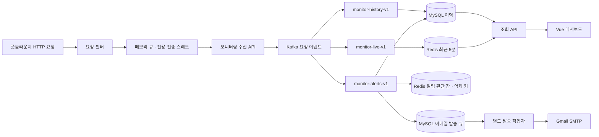

# 현재 구조



풋볼라운지는 모니터링 MySQL·Redis·Kafka에 직접 연결하지 않습니다. 요청 필터는 이벤트를 메모리 큐에 넣고 별도 스레드가 모니터링 HTTP API로 전달합니다.

## 이벤트와 수신

```json
{
  "events": [{
    "eventId": "710ac643-ae1e-47e0-9efa-c80630bd136e",
    "serviceKey": "football-lounge",
    "environment": "development",
    "method": "GET",
    "route": "/api/v1/monitoring-demo/items/{itemId}",
    "statusCode": 200,
    "durationMs": 12,
    "occurredAt": "2026-10-14T11:00:00Z",
    "deploymentVersion": "local-monitoring"
  }]
}
```

요청별 UUID를 만들며 재전송할 때 유지합니다. 원래 URL 대신 Spring MVC 라우트 패턴을 기록합니다. 컨트롤러에 도달하기 전에 인증에서 거절되면 `UNMATCHED`로 기록합니다. 본문·쿼리·헤더·토큰·사용자 정보는 모니터링 이벤트에 포함하지 않습니다. 기존 풋볼라운지 자체 로그 정책은 이 모듈과 별개입니다.

수집 범위는 동기 `/api/**` 요청입니다. 헬스 체크와 전송기 진단 경로는 제외하며 WebSocket·비동기 Servlet 완료 이벤트는 아직 지원하지 않습니다. 처리 시간은 필터 진입부터 동기 처리 종료까지이며 네트워크 전송 시간을 포함한 사용자 체감 지연과 다릅니다.

수신 API는 전용 키, 등록된 서비스·환경, 필드 제약, 발생 시각(과거 72시간~미래 60초), 배치 크기 1~100을 검증합니다. Kafka 확인을 받은 뒤 202를 반환합니다. 타임아웃 뒤에도 일부 이벤트가 발행됐을 수 있으므로 재전송은 동일한 eventId를 사용합니다. 배치 발행 자체는 트랜잭션이 아닙니다.

## Kafka 역할

- 토픽 `monitor.http-requests.v1`: 파티션 3개, 복제 계수 1, 보존 72시간.
- 키는 `serviceKey:environment`입니다. 같은 서비스의 이벤트는 같은 파티션으로 전달됩니다.
- `monitor-history-v1`: MySQL에 이력을 저장합니다.
- `monitor-live-v1`: Redis의 최근 5분 이벤트를 갱신합니다.
- `monitor-alerts-v1`: 독립된 Redis 창을 갱신한 뒤 기준치를 판단하고 알림을 저장합니다. 실시간 집계 소비자가 먼저 처리됐는지에 의존하지 않습니다.
- 저장에 성공한 레코드의 오프셋을 커밋합니다. 인프라 오류는 재시도하며 해당 소비자의 처리가 지연돼도 다른 그룹은 계속 처리합니다.
- JSON 역직렬화 실패는 `monitor.http-requests.v1.DLT`로 보냅니다. 그룹별 실패 레코드를 각각 포함할 수 있으며 자동 재처리는 없습니다.

소비자들은 같은 JVM에서 실행됩니다. 저장소 실패에 대한 처리 흐름은 분리됐지만 JVM 중단은 세 소비자를 모두 멈춥니다. 브로커도 단일 노드이므로 이 구성은 고가용성을 제공하지 않습니다.

## MySQL과 Redis 역할

MySQL의 `http_request_event.event_id` 기본 키로 중복 저장을 방지합니다. 마지막 수신 시각과 최근 30건 이력은 MySQL에서 조회합니다.

Redis에는 서비스·환경별 ZSET(발생 시각과 ID), HASH(ID와 이벤트)를 저장합니다. Lua 스크립트에서 오래된 이벤트 제거와 중복 ID 확인·저장을 원자적으로 처리하고 360초 TTL을 갱신합니다. 최근 5분 이벤트를 읽어 요청 수, 5xx 오류율, 평균 처리 시간, API별 통계를 계산합니다. 요청이 없으면 요청 수는 0, 오류율과 평균은 `null`입니다. 연결 실패는 0으로 가장하지 않습니다.

Redis 장애 동안 미처리된 Kafka 이벤트는 복구 후 재시도합니다. 5분보다 오래 지연된 이벤트는 실시간 창에 넣지 않지만 MySQL에는 남습니다. 이미 커밋한 데이터가 Redis 데이터 삭제로 사라진 경우 자동 재생하는 기능은 없습니다. 시간별 버킷 사전 집계, Redis 메모리 제한, MySQL 이력 보존·정리도 추후 과제입니다.

## 풋볼라운지 영향 제한

- 큐 최대 2,000건, `offer` 사용으로 요청 스레드가 큐 공간을 기다리지 않습니다.
- 전용 스레드가 1초 간격으로 최대 100건을 보냅니다.
- 연결 제한 500ms, HTTP 요청 제한 2초, 최대 3번 시도합니다.
- 재시도 후 실패하거나 큐가 가득 차면 해당 이벤트를 버립니다. 진단 카운터로 확인할 수 있습니다.
- 큐는 디스크에 저장하지 않아 앱 종료 시 남은 이벤트가 유실될 수 있습니다.

모니터링 전달 실패 때문에 본 서비스 응답이 실패하지 않는 것을 우선한 정책입니다. 모든 요청의 감사 기록을 보장하는 용도로는 사용할 수 없습니다. Kafka 수신 이후 소비자 재시도와 수신 이전 메모리 큐의 유실 정책을 구분해야 합니다.

## 다음 단계

오류율·평균 처리 시간 알림과 Redis 반복 억제를 구현했습니다. Redis 키가 존재하면 DB 쓰기를 건너뛰고, 없을 때만 MySQL 행 잠금 아래 마지막 발송 시각을 확인하고 이력을 저장합니다. 저장을 커밋한 다음 `SET NX`와 남은 TTL로 억제 키를 만듭니다. 자세한 실패 처리와 설정은 [알림 가이드](alerts.md)에 있습니다.

이메일 outbox와 재시도를 구현했습니다. 알림과 메일 작업은 같은 MySQL 트랜잭션으로 저장하고, 발송 작업자는 `FOR UPDATE SKIP LOCKED`로 한 건씩 확보합니다. SMTP 요청 중에는 DB 트랜잭션을 잡아두지 않습니다. 5분 임대와 토큰으로 중단된 작업을 복구하고 오래된 작업자의 상태 덮어쓰기를 막습니다. 발송 경계의 중복 가능성과 설정은 [이메일 가이드](email.md)에 있습니다.

운영 연결 전에는 인증된 조회 화면, TLS, 용량·보존 정책, 수집기 지표와 부하 시험을 추가해야 합니다.
